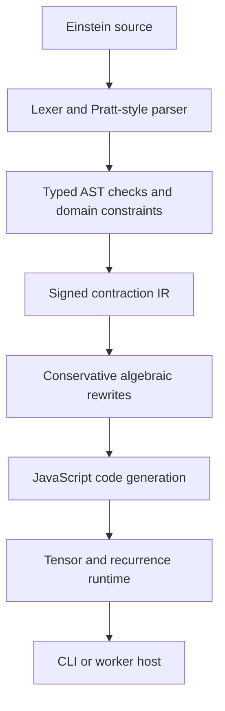

# Compiler and runtime architecture

## Pipeline

`parser.ts` supplies token offsets and a precedence-climbing parser. `ast.ts` contains discriminated AST types and diagnostics. `compiler.ts` collects declarations, checks symbols and arities, infers partial types and shapes, discovers free/dummy indices, and constructs explicit domains and term reductions. Each IR term contains its expression, sign, and ordered reduction axes. The source AST and inferred binding types remain available for inspection.

Code generation emits direct JavaScript expressions, named pure functions, immutable records, checked tensor reads, lazy tensor generators, and scalar reduction callbacks. It does not interpret an AST at runtime. There is no host-code interpolation primitive in Einstein. The `new Function` boundary is solely the compiler host's mechanism to execute generated JavaScript. The CLI can instead write an ES module importing `runtime.js`.

## Runtime representation

A Tensor stores its shape, a private reader, and a storage tag. Dense equations memoize demanded coordinates in optimized mode, or eagerly materialize their coordinate map in naive mode. Numeric sparse literals use a coordinate-to-value map with implicit zero. Ordinary nested arrays are deeply frozen, and their shape may be cached after validation. Bounds and runtime domain equality are checked explicitly.

Scalar products inside contractions are fused into reduction callbacks; an N-dimensional elementwise product tensor is never required. Naive reductions materialize a term array; optimized reductions accumulate without it. Named tensor intermediates remain bindings. An optimized intermediate is demanded on access, but there is no cross-binding producer-consumer fusion or liveness-based memory reclamation.

`iterate` runs an immutable state recurrence using a host loop to avoid growing the call stack. Named recursive functions are ordinary JavaScript calls and can overflow the stack. Exact BigInt counters provide the arithmetic used in the universality proof.

## Browser host

The source editor is a textarea over a syntax-highlighted preformatted layer. The app uses module workers for compilation and execution. It displays generated JavaScript, IR, outputs, tensor tables/heatmaps, optimization notes count, and local timing measurements. Computations have a 5-second worker timeout and function fuel. The execute timing includes full output materialization; parsing/code generation is measured separately, and JavaScript function construction is outside execute timing.

Reactive programs export initial state, a reducer, and a view function. Events are sent to the worker; a new immutable state and pure view record come back. The DOM adapter uses element creation and textContent. SVG output supports numerical polylines. UI search and empty-result selection are computed in Einstein, while input controls and DOM rendering are host adapters. It is a small rendering protocol, not a general virtual DOM.

## Trade-offs

| Decision | Benefit | Cost / deferred work |
|---|---|---|
| No third-party runtime/build packages | Reproducible with Node 24 alone | Build uses Node's experimental TypeScript stripping API; no tsc type-check step |
| Partial inference with dynamic guards | Small working language quickly | Unknown function/record types; no static soundness theorem |
| Exact BigInt counters separate from numeric arrays | Honest unbounded-counter semantics | Scalar representations can disagree; mixed arithmetic must be avoided |
| Sparse coordinate maps | Simple sparse literal representation | Dense reduction loops; no CSR/COO schedule compiler |
| Memoized lazy equations | Avoid unnecessary element computation | Map keys, bounds checks, and callbacks are expensive |
| Conservative vector delta rewrite | Measurable symbolic simplification | Does not cover general symbolic tensor algebra |
| Worker isolation and timeout | Keeps page responsive to most runaway programs | Not hardened memory/resource security |
| Minimal view records | Counter/search/SVG with no framework dependency | No arbitrary HTML, layout language, or complete component system |

## Parallelization analysis

Output coordinates of a pure tensor equation are independent once their inputs are fixed. A future worker scheduler could partition the free-index domain and transfer typed buffers, with one writer per output coordinate. Sparse reductions would first require partitioning a suitable sparse iteration space. Recurrences generally have sequential state dependencies. Reductions can use trees mathematically, but changing summation order changes floating-point rounding; deterministic parallel reduction requires an explicit policy. No parallel speedup is claimed or implemented.

## React stretch design

A React adapter could own the event queue with `useReducer`, hold worker results in state, and map supported pure view tags into components. Tensor kernels should stay in the worker rather than execute during render. Cancellation and version IDs would be needed to prevent older results replacing newer ones in a concurrent UI. The project implements the framework-independent protocol only; a React integration is not shipped.

## Documentation and evolving automata

The documentation reader prominently links the article, specification, proof, architecture, optimizations, and benchmark tables. Complete article snippets can be opened in the editor. KaTeX 0.19.1 is loaded from jsDelivr using the official browser template's integrity hashes; it typesets display mathematics without permitting trusted HTML commands. Raw LaTeX remains the fallback when the renderer is unavailable. This optional frontend CDN dependency does not affect compiler/runtime or local build dependencies. A content hash versions the frontend asset URLs to avoid stale JavaScript after Pages deployments.

Life emits an `automaton` view record. Its event reducer computes a whole next generation using contextual `grid`, then `realize` copies that finite result into immutable storage so successive generations do not retain an ever-growing lazy closure chain. The host supplies a 250ms clock, Play/Pause, Step, Reset, and a generation counter. Computation remains in Einstein; the host does not implement Conway's rules. Function fuel is refreshed per event, and each event has a wall-clock timeout.
